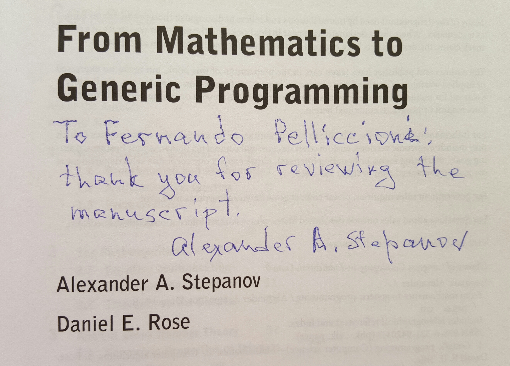
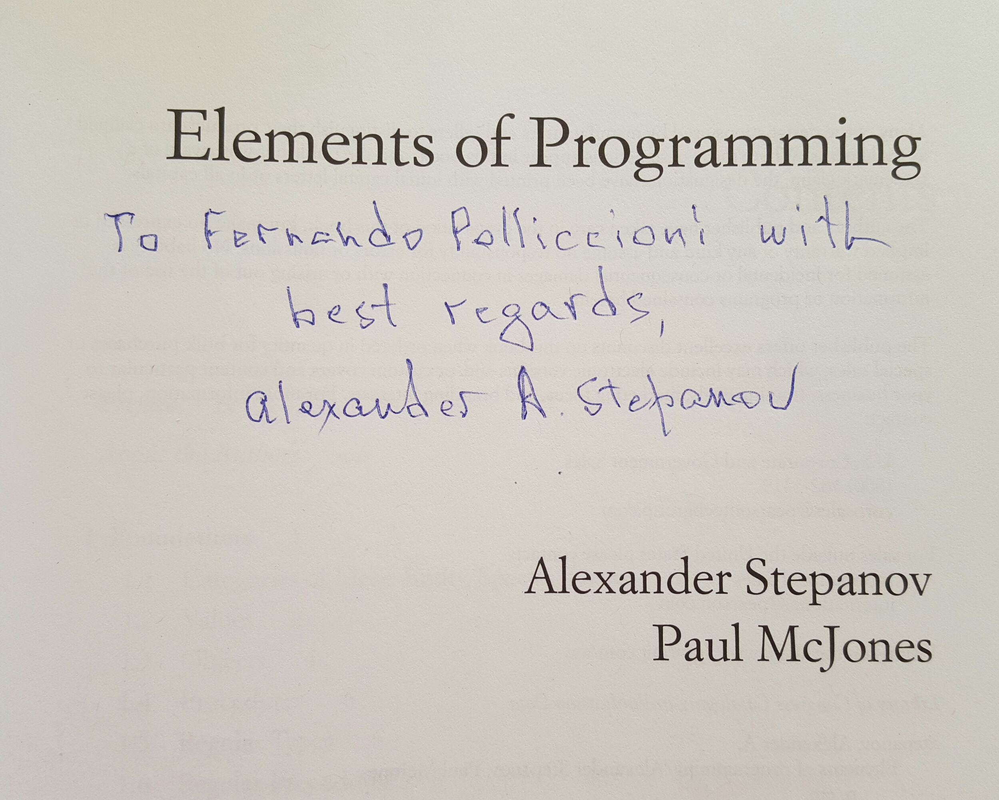
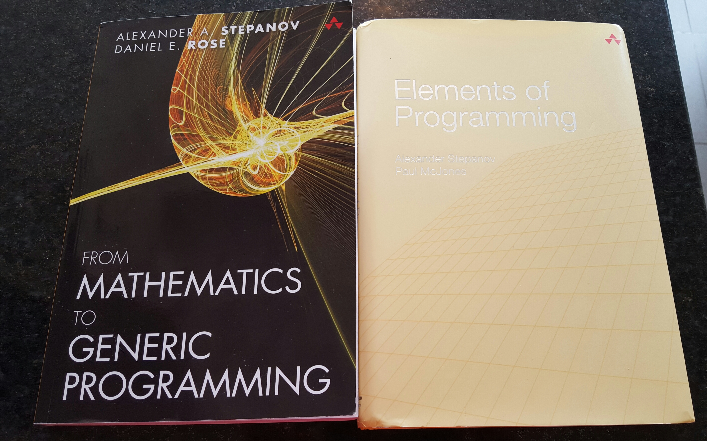

---
{
  "title": "Thanks Alex!",
  "url": "/thanks-alex/",
  "lang": "en",
  "date": "2015-11-25T09:00:00-03:00",
  "type": "post",
  "published": true,
  "comments": true,
  "tags": [
    "components",
    "programming",
    "components programming",
    "componentsprogramming",
    "stepanov",
    "knuth",
    "stroustrup",
    "generic",
    "genericprogramming",
    "generic programming",
    "genericity",
    "concepts",
    "math",
    "mathematics",
    "elements",
    "eop",
    "contracts",
    "performance",
    "c++",
    "cpp",
    "c",
    "java",
    "dotnet",
    "c#",
    "csharp",
    "python",
    "ruby",
    "javascript",
    "haskell",
    "dlang",
    "rust",
    "golang",
    "eiffel",
    "templates",
    "metaprogramming",
    "book",
    "fmgp"
  ],
  "translationKey": "thanks-alex"
}
---
I am very pleased to have received these two gifts.

These are two great books.

It is an honor for me that are autographed by one of the greatest of our discipline.

Do not deprive the pleasure of reading them.

[Elements of Programming on Amazon](http://www.amazon.com/Elements-Programming-Alexander-A-Stepanov/dp/032163537X/).

[From Mathematics to Generic Programming on Amazon](http://www.amazon.com/Mathematics-Generic-Programming-Alexander-Stepanov/dp/0321942043/).

Thanks again, Alex!
