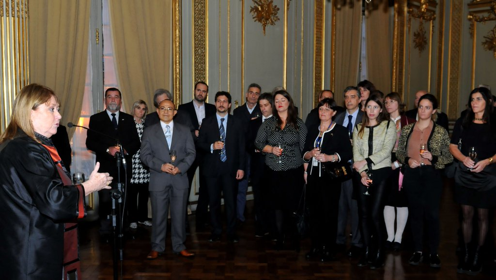
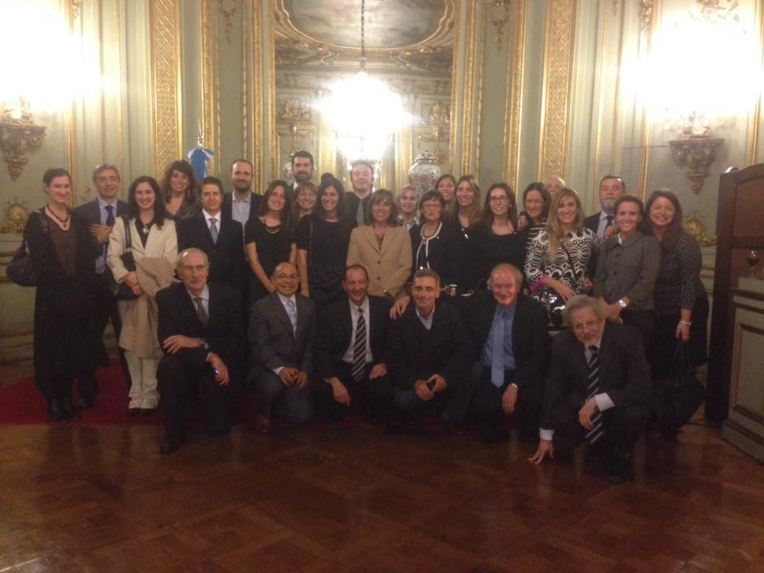

---
{
  "title": "Vin d'honneur",
  "url": "/wine-honour/",
  "lang": "en",
  "date": "2016-05-04T09:00:00-03:00",
  "type": "post",
  "published": true,
  "comments": true,
  "tags": [
    "copla",
    "gis",
    "programming",
    "geography",
    "math",
    "mathematics",
    "geophysics",
    "stepanov",
    "knuth",
    "stroustrup",
    "generic",
    "genericprogramming",
    "generic programming",
    "genericity",
    "concepts",
    "c++",
    "cpp",
    "c",
    "java",
    "dotnet",
    "c#",
    "csharp",
    "python",
    "ruby",
    "javascript",
    "haskell",
    "dlang",
    "rust",
    "golang",
    "eiffel"
  ],
  "translationKey": "wine-honour"
}
---
On May 4, 2016, I was invited by the Argentine Minister of Foreign Affairs, [Susana Malcorra](https://twitter.com/SusanaMalcorra), to the *Vin d'honneur* (Wine of Honor) that took place in the Golden Hall of the San Martín Palace, on the occasion of the Salute to the members of the [National Commission on the Outer Limit of the Continental Shelf (COPLA)](http://www.plataformaargentina.gov.ar/en/(copla_i)).

**Many thanks to the Minister and congratulations to the whole team!**

---

> The most extensive limit of Argentina - Our border with humanity

---

### References

[Official Twitter of Susana Malcorra](https://twitter.com/SusanaMalcorra/status/727976624239554560)

---
