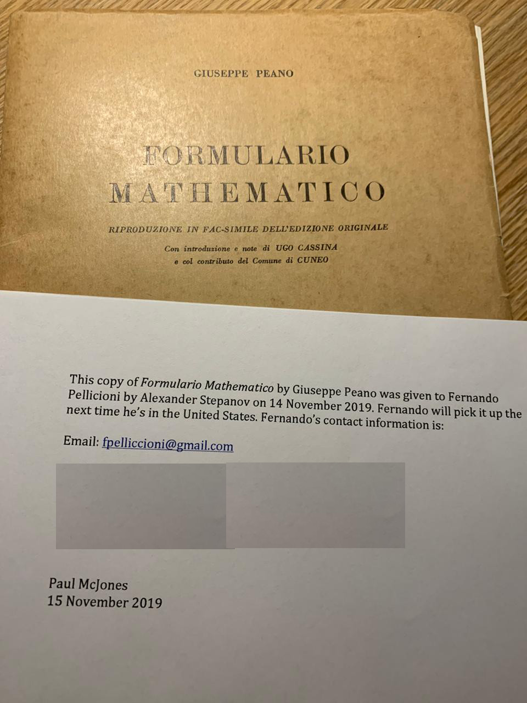

---
{
  "title": "Thanks Alex, once again!",
  "url": "/thanks-alex-once-again/",
  "lang": "en",
  "date": "2020-02-20T09:00:00-03:00",
  "type": "post",
  "published": true,
  "comments": true,
  "tags": [
    "components",
    "programming",
    "components programming",
    "componentsprogramming",
    "stepanov",
    "knuth",
    "stroustrup",
    "generic",
    "genericprogramming",
    "generic programming",
    "genericity",
    "concepts",
    "math",
    "mathematics",
    "elements",
    "eop",
    "contracts",
    "performance",
    "c++",
    "cpp",
    "c",
    "java",
    "dotnet",
    "c#",
    "csharp",
    "python",
    "ruby",
    "javascript",
    "haskell",
    "dlang",
    "rust",
    "golang",
    "eiffel",
    "templates",
    "metaprogramming",
    "book",
    "fmgp"
  ],
  "translationKey": "thanks-alex-once-again"
}
---

Once again, I would like to thank my friends Alex Stepanov and Paul McJones for this beautiful gift.

I have been looking for this book for years. It is a very difficult book to get.

I have no words to thank you.

Thank you!
