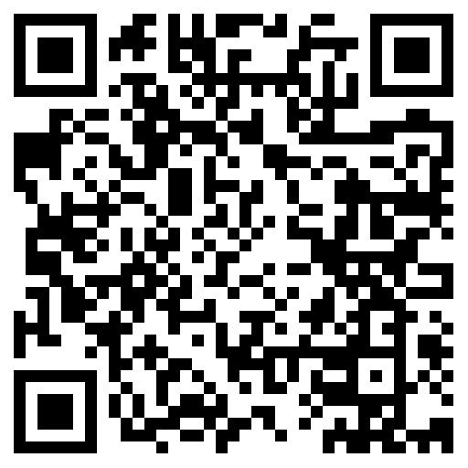
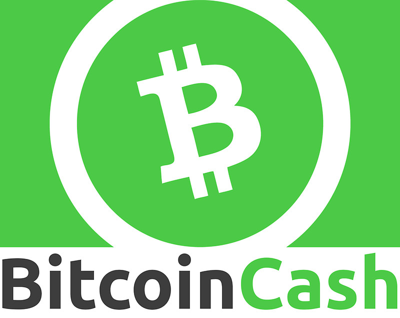
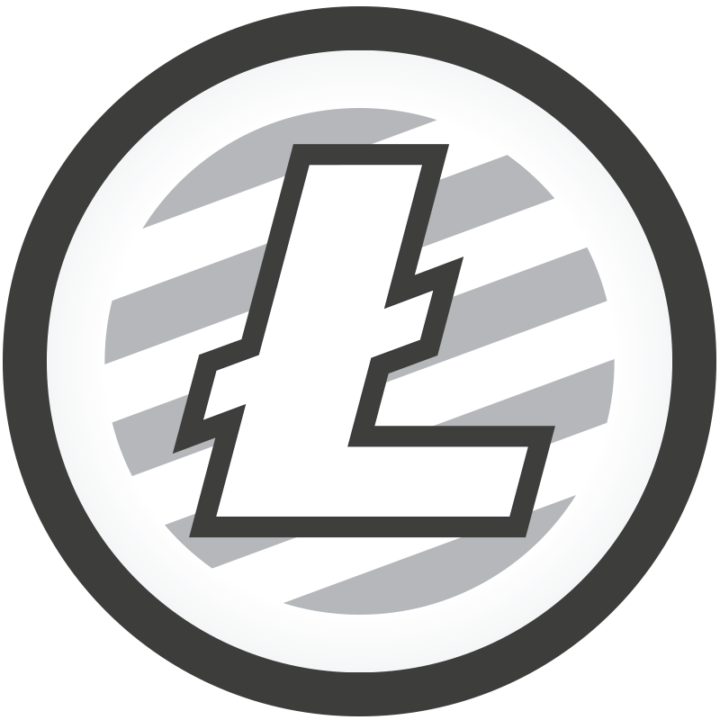

---
{
  "title": "Donaciones",
  "url": "/donaciones/",
  "lang": "es",
  "date": "2017-12-21T09:00:00-03:00",
  "type": "page",
  "published": true,
  "comments": false,
  "tags": [
    "components",
    "programming",
    "components programming",
    "componentsprogramming",
    "stepanov",
    "knuth",
    "stroustrup",
    "generic",
    "genericprogramming",
    "generic programming",
    "genericity",
    "concepts",
    "math",
    "mathematics",
    "elements",
    "eop",
    "contracts",
    "performance",
    "c++",
    "cpp",
    "c",
    "java",
    "dotnet",
    "c#",
    "csharp",
    "python",
    "ruby",
    "javascript",
    "haskell",
    "dlang",
    "rust",
    "golang",
    "eiffel",
    "templates",
    "metaprogramming"
  ],
  "translationKey": "donate",
  "feature": "/images/soft-trees.jpg"
}
---
Si el contenido de este blog le resulta interesante, podría colaborar conmigo para que siga escribiendo.


Puede respaldar a _Components Programming_ via <a href="https://www.paypal.me/algorismi/5" target="_blank">PayPal</a>, <a href="https://commerce.coinbase.com/checkout/6c06a644-c63c-489e-a78b-654bdb137541" target="_blank">Coinbase</a> o un pago directo Bitcoin Cash usando la dirección de abajo.

(Los montos inferiores a $1 no suelen llegar a mi cuenta luego del pago de comisiones. Por favor sea paciente; Algunas transacciones, especialmente utilizando criptomonedas, pueden tardar una o dos horas en completarse.)


### Formato CashAddr de BCH:


```cpp

bitcoincash:qq0jaxy09a8m9u9xe6nry354l8n4y3fdyyfnykj643

```





<br><br>
<br><br>
<br><br>
<br><br>
<br><br>
---
---

<!--





 -->
