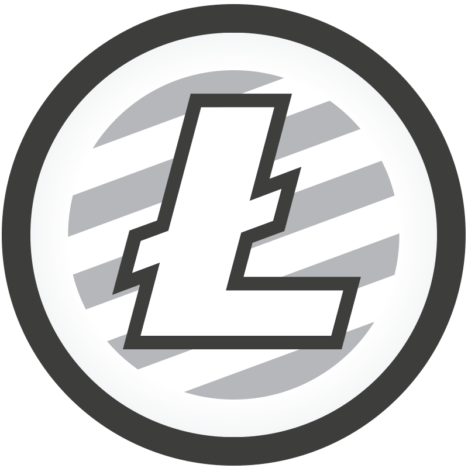

---
{
  "title": "Donaciones Bitcoin Cash",
  "url": "/donaciones-bch/",
  "lang": "es",
  "date": "2019-02-01T09:00:00-03:00",
  "type": "page",
  "published": true,
  "comments": false,
  "tags": [
    "components",
    "programming",
    "components programming",
    "componentsprogramming",
    "stepanov",
    "knuth",
    "stroustrup",
    "generic",
    "genericprogramming",
    "generic programming",
    "genericity",
    "concepts",
    "math",
    "mathematics",
    "elements",
    "eop",
    "contracts",
    "performance",
    "c++",
    "cpp",
    "c",
    "java",
    "dotnet",
    "c#",
    "csharp",
    "python",
    "ruby",
    "javascript",
    "haskell",
    "dlang",
    "rust",
    "golang",
    "eiffel",
    "templates",
    "metaprogramming"
  ],
  "translationKey": "donate-bch",
  "feature": "/images/soft-trees.jpg"
}
---
Si el contenido de este blog le resulta interesante, podría colaborar conmigo para que siga escribiendo.

_Formato CashAddr de BCH:_


```cpp

bitcoincash:qq0jaxy09a8m9u9xe6nry354l8n4y3fdyyfnykj643

```


<br><br>
<br><br>
<br><br>
<br><br>
<br><br>
---
---

<!--




 -->
