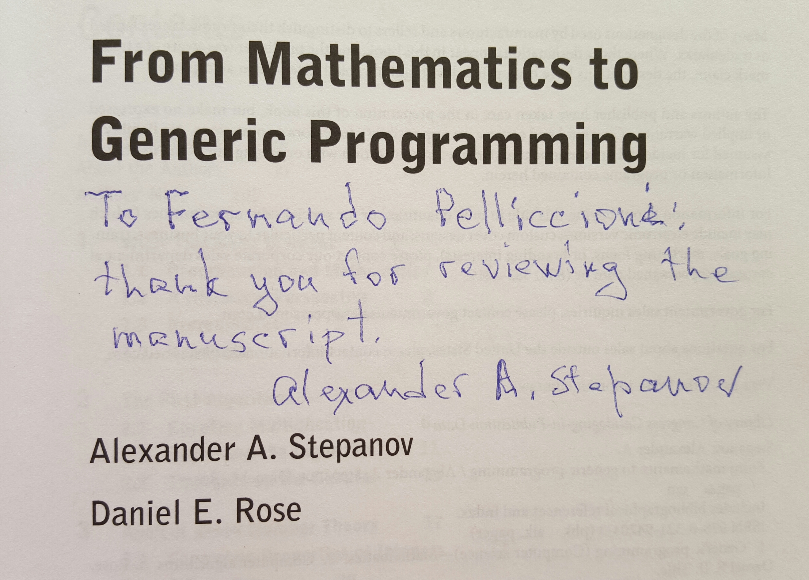
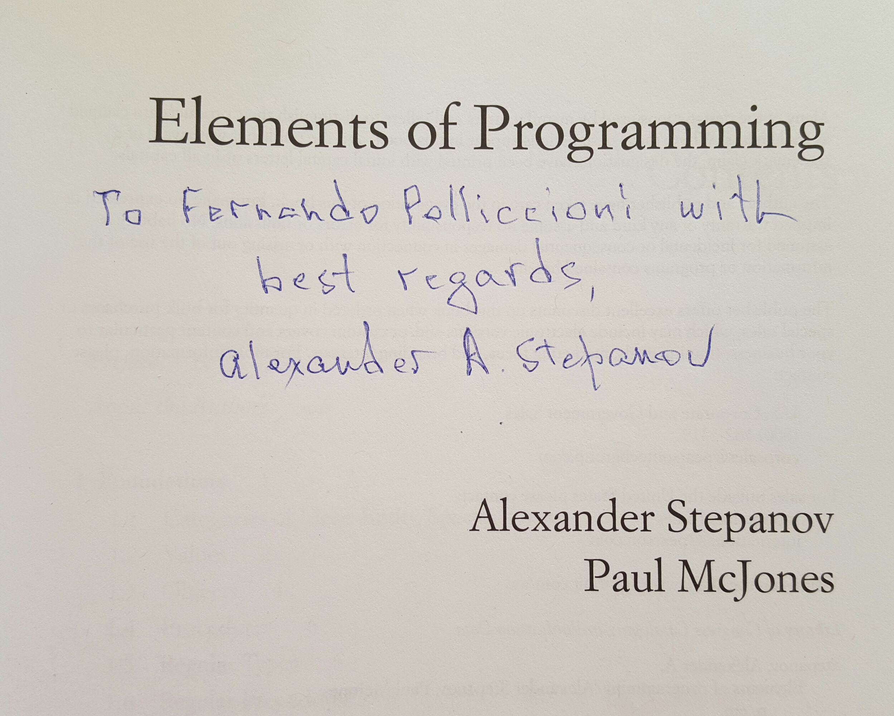
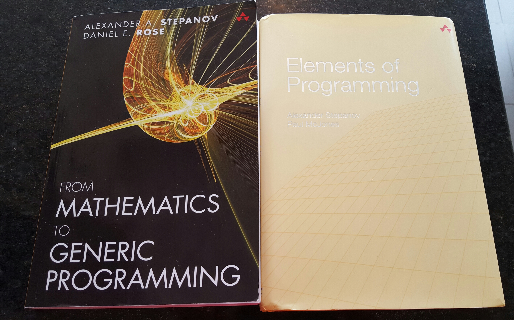

---
{
  "title": "¡Gracias Alex!",
  "url": "/gracias-alex/",
  "lang": "es",
  "date": "2015-11-25T09:00:00-03:00",
  "type": "post",
  "published": true,
  "comments": true,
  "tags": [
    "components",
    "programming",
    "components programming",
    "componentsprogramming",
    "stepanov",
    "knuth",
    "stroustrup",
    "generic",
    "genericprogramming",
    "generic programming",
    "genericity",
    "concepts",
    "math",
    "mathematics",
    "elements",
    "eop",
    "contracts",
    "performance",
    "c++",
    "cpp",
    "c",
    "java",
    "dotnet",
    "c#",
    "csharp",
    "python",
    "ruby",
    "javascript",
    "haskell",
    "dlang",
    "rust",
    "golang",
    "eiffel",
    "templates",
    "metaprogramming",
    "book",
    "fmgp"
  ],
  "translationKey": "thanks-alex"
}
---
Estoy muy contento de haber recibido estos dos regalos.

Son dos excelentes libros.

Es un honor para mí que estén autografiados por uno de los más grandes de nuestra disciplina.

No te prives del placer de leerlos.

[Elements of Programming en Amazon](http://www.amazon.com/Elements-Programming-Alexander-A-Stepanov/dp/032163537X/).

[From Mathematics to Generic Programming en Amazon](http://www.amazon.com/Mathematics-Generic-Programming-Alexander-Stepanov/dp/0321942043/).

¡Gracias nuevamente Alex!
