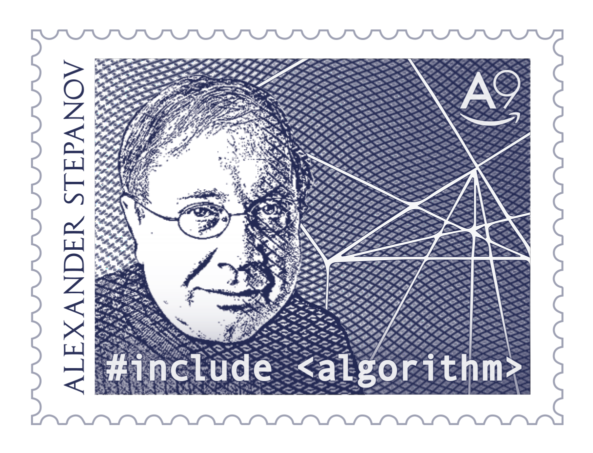

---
{
  "title": "Alex se jubiló",
  "url": "/jubilacion-alex/",
  "lang": "es",
  "date": "2016-01-14T09:00:00-03:00",
  "type": "post",
  "published": true,
  "comments": true,
  "tags": [
    "components",
    "programming",
    "components programming",
    "componentsprogramming",
    "stepanov",
    "knuth",
    "stroustrup",
    "generic",
    "genericprogramming",
    "generic programming",
    "genericity",
    "concepts",
    "math",
    "mathematics",
    "elements",
    "eop",
    "contracts",
    "performance",
    "c++",
    "cpp",
    "c",
    "java",
    "dotnet",
    "c#",
    "csharp",
    "python",
    "ruby",
    "javascript",
    "haskell",
    "dlang",
    "rust",
    "golang",
    "eiffel",
    "templates",
    "metaprogramming",
    "book",
    "fmgp"
  ],
  "translationKey": "alex-retirement"
}
---
Alex se ha jubilado.

Les comparto una estampilla conmemorativa, diseñada por [Joyce Croft](https://twitter.com/joycecroft) y Alexander Zeyliger de [A9](http://a9.com/).



Tengo que confesar que siento tristeza, ya que me hubiera gustado que Alex siga aportando ideas por mucho tiempo más tiempo.\
Pero se ha retirado y estoy feliz por él.

Le deseo tenga un excelente y merecido descanso con su familia y amigos.


```cpp

auto who = successor(alex);

```


¡Gracias!
