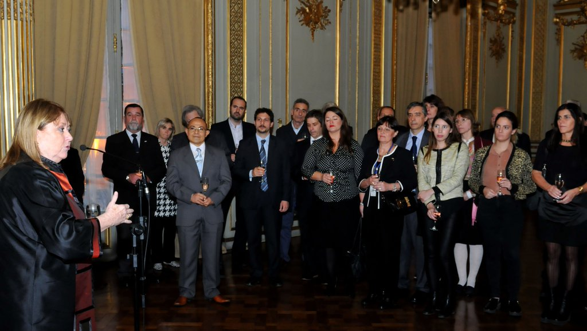
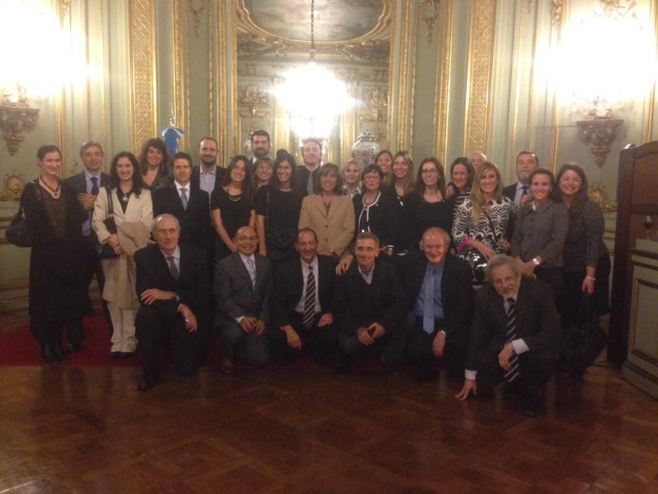

---
{
  "title": "Invitación a Vino de Honor",
  "url": "/vino-honor/",
  "lang": "es",
  "date": "2016-05-04T09:00:00-03:00",
  "type": "post",
  "published": true,
  "comments": true,
  "tags": [
    "copla",
    "gis",
    "programming",
    "geography",
    "math",
    "mathematics",
    "geophysics",
    "stepanov",
    "knuth",
    "stroustrup",
    "generic",
    "genericprogramming",
    "generic programming",
    "genericity",
    "concepts",
    "c++",
    "cpp",
    "c",
    "java",
    "dotnet",
    "c#",
    "csharp",
    "python",
    "ruby",
    "javascript",
    "haskell",
    "dlang",
    "rust",
    "golang",
    "eiffel"
  ],
  "translationKey": "wine-honour"
}
---
El día 4 de mayo de 2016, he sido invitado por la señora Ministra de Relaciones Exteriores y Culto (Canciller), Da. [Susana Malcorra](https://twitter.com/SusanaMalcorra), al _Vino de Honor_ que tuvo lugar en el Salón Dorado del Palacio San Martín, en ocasión del Saludo a los miembros de la [Comisión Nacional del Límite Exterior de la Plataforma Continental (COPLA)](http://www.plataformaargentina.gov.ar/).

**¡Muchas gracias a la Sra. Canciller y felicitaciones a todo el equipo!**

---

> El límite más extenso de la Argentina – Nuestra frontera con la humanidad

---

### Referencias

[Twitter oficial de Susana Malcorra](https://twitter.com/SusanaMalcorra/status/727976624239554560)

---
