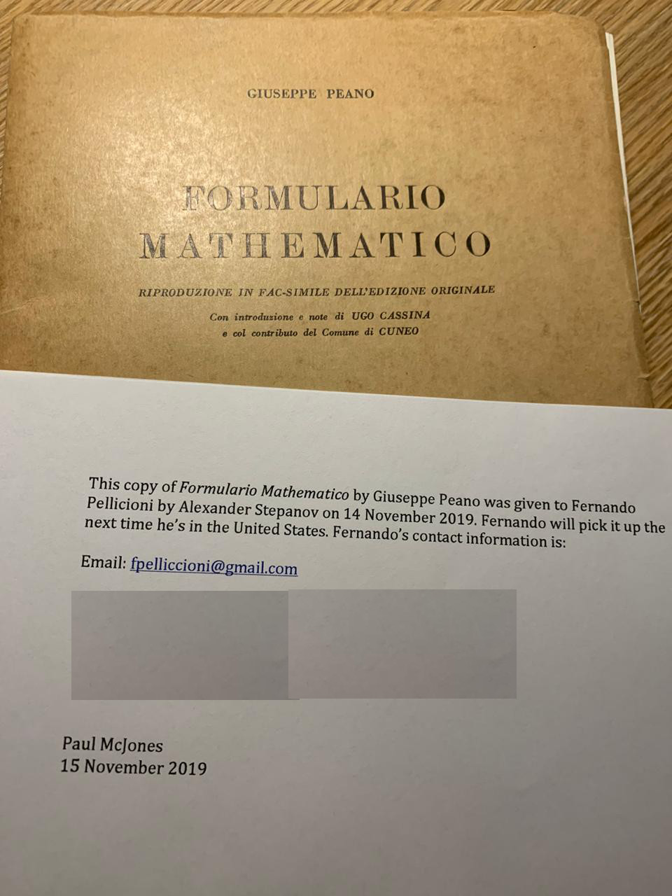

---
{
  "title": "¡Gracias nuevamente, Alex!",
  "url": "/gracias-alex-nuevamente/",
  "lang": "es",
  "date": "2020-02-20T09:00:00-03:00",
  "type": "post",
  "published": true,
  "comments": true,
  "tags": [
    "components",
    "programming",
    "components programming",
    "componentsprogramming",
    "stepanov",
    "knuth",
    "stroustrup",
    "generic",
    "genericprogramming",
    "generic programming",
    "genericity",
    "concepts",
    "math",
    "mathematics",
    "elements",
    "eop",
    "contracts",
    "performance",
    "c++",
    "cpp",
    "c",
    "java",
    "dotnet",
    "c#",
    "csharp",
    "python",
    "ruby",
    "javascript",
    "haskell",
    "dlang",
    "rust",
    "golang",
    "eiffel",
    "templates",
    "metaprogramming",
    "book",
    "fmgp"
  ],
  "translationKey": "thanks-alex-once-again"
}
---

Una vez más, me gustaría agradecerle a mis amigos Alex Stepanov y Paul McJones por este hermoso regalo.

He estado buscando este libro por años. Es un libro muy difícil de conseguir.

No tengo palabras para agradecerles.

Simplemente, ¡gracias!
